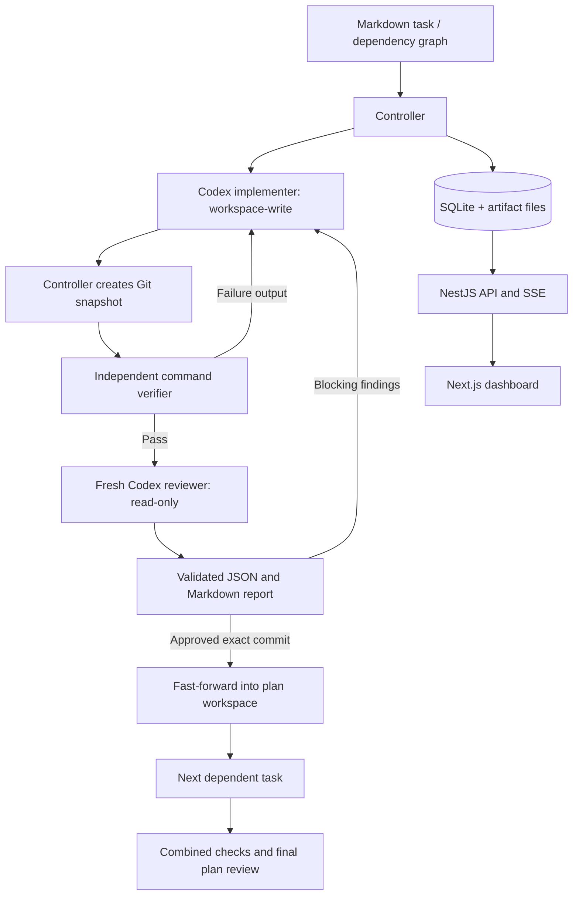

# Architecture

AI Flow has two AI roles and a deterministic TypeScript controller. The controller, rather than agent prose, owns state transitions and delivery decisions.

## Data contracts

Shared contracts live in `packages/shared/src/index.ts`. A plan captures repository/task paths, the source base commit, the full task Markdown, agent settings, checks, budgets, execution history, task reviews, and final verification. SQLite stores complete plan snapshots and an append-only activity stream. Review and check artifacts live in the controller data directory outside the role’s worktree.

A task has a stable ID, title, Markdown, dependencies, phase, current round, repair count, base/candidate/approved/integrated commits, latest check results, and all review rounds. One task is simply a one-node plan.

## States

Plan states: `queued → running → completed`. A running plan can become `paused`, `cancelled`, or `needs_attention`. Paused and attention states can resume. Cancelled and completed states are terminal.

Task phases: `queued → implementing → checking → reviewing → approved`. Check failures and blocking reviews return to `fixing`, then checks and review. The task’s round increases after a rejected review; check failures have a separate repair limit. Final integration repairs use the same two roles in the integration worktree.

## Commit and approval invariants

1. Source repositories must be clean and have a commit at plan creation. The source base commit is captured immediately.
2. The controller creates an integration worktree and one task worktree at a time from the currently integrated result. Separate ref namespaces avoid Git’s branch-prefix collision rule.
3. The controller stages and commits implementation output. Agents are instructed not to commit, push, merge, or deploy.
4. Checks execute against the candidate commit. A tracked or untracked workspace change after checks invalidates that snapshot. Repositories should ignore normal build/test artifacts. Task worktrees live under a separate `tasks/` directory so task IDs cannot collide with the integration workspace.
5. The reviewer receives requirements, exact base/candidate commits, verifier results, and the prior review when present. It gets a fresh session and read-only repository policy.
6. Structured reviews are schema-validated. Approval with blocking findings and rejection without blocking findings are invalid. Optional suggestions do not hold the loop open.
7. A clean approved commit is fast-forwarded into the integration branch. Integration is idempotent and checks already integrated task commits are ancestors of the current branch.
8. The full plan receives combined checks and a fresh final review. Integration defects return to the implementer with all task requirements and unit-test obligations.

The checker cannot establish semantic test completeness; reviewer instructions explicitly require assessment of new/updated behavior tests. AI review can make mistakes, and task-level approval does not replace final integrated verification.

## Runtime adapter

`CodexConnection` speaks JSON-RPC over a private child process’s stdio. It performs the initialize/initialized handshake, reads the model catalog, starts isolated threads, starts turns with role-specific permissions, collects progress and usage, validates final reviewer JSON, and closes the connection.

The installed runtime’s `model/list` controls valid model/effort choices. Unsupported settings fail rather than being downgraded. Authentication is delegated to Codex. The catalog can be cached or bundled, so it is not proof of model entitlement. Interactive input or approval requests fail with a visible attention state rather than hanging the workflow.

The demo adapter is a separate deterministic implementation restricted to repositories with an AI Flow fixture marker. It performs real file changes; the controller still runs real tests and Git operations. Its verdicts are scripted to demonstrate rejection and repair. It never invents usage or makes model calls.

## Durability and cancellation

The controller writes a checkpoint at each stage and before/after agent attempts. A one-second heartbeat persists active elapsed time. One controller process owns a data-directory lock, and only one plan runs at a time. SQLite uses WAL.

Pause/cancel signal the running agent or command process. On graceful shutdown the active run pauses. Startup converts previously running plans to paused and unfinished attempts to interrupted. Resume reruns incomplete work rather than claiming an interrupted operation succeeded. A newly created but unrecorded worktree can be recovered by its managed path and branch.

Durability is checkpoint-based, not exactly-once execution. A crash can repeat an unfinished agent invocation or check; external side effects in repository scripts are not rolled back. Execution should use repeatable development/test commands.

## Usage and budgets

Each invocation stores its latest cumulative primary-thread usage report. Repeated notifications replace that invocation’s snapshot. Totals sum invocation totals, without separately adding cached input or reasoning output. Unknown usage stays unknown. Nested-agent usage is limited to what the runtime includes in reports; comprehensive provider billing reconciliation is outside this version.

Review rounds, failed-check repair attempts, active elapsed time, and reported tokens bound execution. Limits are checked between stages and as timer/usage events arrive. In-flight requests may exceed a token threshold before usage arrives. Limits can be explicitly changed on inactive runs and the change is recorded as an event.

## API

| Endpoint                               | Purpose                                               |
| -------------------------------------- | ----------------------------------------------------- |
| `GET /api/health`                      | Controller health                                     |
| `GET /api/state`                       | Dashboard state and recent events                     |
| `GET/PUT /api/config`                  | Default configuration                                 |
| `POST /api/runtime/refresh`            | Codex authentication/catalog status                   |
| `GET /api/tasks?path=…`                | Parse and preview Markdown tasks                      |
| `POST /api/plans`                      | Create a captured task/plan run                       |
| `GET /api/plans/:id`                   | Full persisted run                                    |
| `POST /api/plans/:id/start`            | Start or resume                                       |
| `POST /api/plans/:id/pause`            | Interrupt and pause                                   |
| `POST /api/plans/:id/cancel`           | Cancel, preserving artifacts                          |
| `PATCH /api/plans/:id/limits`          | Explicit budget adjustment                            |
| `GET /api/plans/:id/diff?taskId=…`     | Recorded candidate diff                               |
| `GET /api/plans/:id/reviews/:reviewId` | Download Markdown review                              |
| `GET /api/events?planId=…&after=…`     | Persisted activity                                    |
| `GET /api/stream`                      | Live event notifications via SSE                      |
| `POST /api/demo`                       | Create an isolated demo; optional `{ "start": true }` |

## Boundaries

This version is local and single-user, with sequential plan execution. It does not provide remote multi-tenant authentication, parallel scheduling, automated source-branch merging, production deployment, model billing reconciliation, or exactly-once external side effects. Worktrees and artifacts are deliberately retained for inspection; automatic pruning is not enabled.
