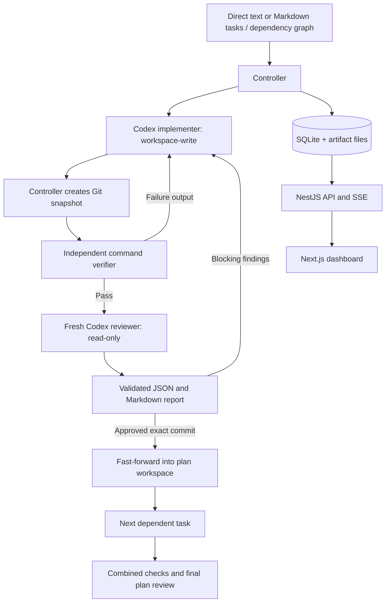

# Architecture

AI Flow has two AI roles and a deterministic TypeScript controller. The controller, rather than agent prose, owns state transitions and delivery decisions.

## Data contracts

Shared contracts live in `packages/shared/src/index.ts`. A plan captures repository/task paths, the source base commit, the full task Markdown, agent settings, checks, budgets, execution history, task reviews, and final verification. SQLite stores complete plan snapshots and an append-only activity stream. Projects own a canonical repository path and editable defaults; every new plan has a project ID and captures those defaults. Generated Markdown, reviews, and check artifacts live in `<repository>/.ai-flow/runs/<run-id>` outside the role’s worktree. When `config.useWorktree` is true (the backward-compatible default), worktrees live in `<repository>/.ai-flow/worktrees/<run-id>`. When false, the integration workspace and every task workspace are the project repository itself, on its checked-out branch. `POST /api/plans` accepts an optional `useWorktree` boolean to override project defaults for that run. The controller directory holds the global SQLite registry. Legacy plans retain their captured workspace/report paths and are associated with projects during startup migration.

A task has a stable ID, title, Markdown, dependencies, phase, current round, repair count, base/candidate/approved/integrated commits, latest check results, and all review rounds. One task is simply a one-node plan. `POST /api/plans` accepts `taskText` for a single direct-input task, mutually exclusive with `taskPath` and `taskIds`. A name is optional. File tasks accept arbitrary text/Markdown; frontmatter is optional, IDs default to safe filename-derived values, and the complete original text is preserved. Empty tasks are rejected.

## States

Plan states: `queued → running → completed`. A running plan can become `paused`, `cancelled`, or `needs_attention`. Paused and attention states can resume. Cancelled and completed states are terminal.

Task phases: `queued → implementing → checking → reviewing → approved`. Check failures and blocking reviews return to `fixing`, then checks and review. The task’s round increases after a rejected review; check failures have a separate repair limit. Final integration repairs use the same two roles in the integration worktree.

## Commit and approval invariants

1. Source repositories must have a commit at plan creation. No source working-tree cleanliness check is performed. The source base commit is captured immediately; pre-existing staged, unstaged, and untracked files stay in the source repository and are excluded from workflow commits.
2. With worktrees enabled, the controller creates an integration worktree and one task worktree at a time from the currently integrated result. Separate ref namespaces avoid Git’s branch-prefix collision rule.
3. The controller stages and commits implementation output. Agents are instructed not to commit, push, merge, or deploy.
4. Checks execute against the candidate commit. A tracked or untracked workspace change after checks invalidates that snapshot. Repositories should ignore normal build/test artifacts. Task worktrees live under a separate `tasks/` directory so task IDs cannot collide with the integration workspace.
5. The reviewer receives requirements, exact base/candidate commits, verifier results, and the prior review when present. It gets a fresh session and read-only repository policy.
6. Structured reviews are schema-validated. Approval with blocking findings and rejection without blocking findings are invalid. Optional suggestions do not hold the loop open.
7. With worktrees enabled, a clean approved commit is fast-forwarded into the integration branch. In current-branch mode, task commits are already on the output branch and integration only verifies ancestry. Integration is idempotent and checks already integrated task commits are ancestors of the current branch.
8. The full plan receives combined checks and a fresh final review. Integration defects return to the implementer with all task requirements and unit-test obligations.

The checker cannot establish semantic test completeness; reviewer instructions explicitly require assessment of new/updated behavior tests. AI review can make mistakes, and task-level approval does not replace final integrated verification.

## Current-branch execution

`useWorktree: false` captures the checked-out branch, HEAD, and a Git tree of the working files at first execution, without changing the user’s index. The baseline persists across pause/restart, including interrupted agent edits. Detached HEAD is rejected; branch/HEAD changes outside the controller stop the run rather than redirecting its commits.

The controller computes the binary diff from the previous working-files baseline to the agent output. It applies that delta independently to temporary indexes initialized from HEAD and the user’s existing index. A three-way application supports non-overlapping edits in a partially staged file. A conflict leaves HEAD, files, and the real index unchanged. A successful checkpoint advances the current branch with only the workflow delta, installs the updated index with user staging preserved, and updates the baseline. Private `refs/ai-flow-snapshots/<run-id>` refs retain baseline objects for resume. A durable checkpoint journal allows recovery between the branch-ref update, index replacement, and SQLite persistence.

Checks and reviews run against the live files, including existing user edits. Records include `workspaceTree` / `reviewedWorkspaceTree` alongside the tested/reviewed commit; post-check/review validation compares the live tree with that snapshot instead of requiring a clean directory. Current-branch mode requires pausing before other edits: changes made concurrently in the directory cannot be distinguished from agent output.

## Runtime adapter

`CodexConnection` speaks JSON-RPC over a private child process’s stdio. It performs the initialize/initialized handshake, reads the model catalog, starts isolated threads, starts turns with role-specific permissions, collects progress and usage, validates final reviewer JSON, and closes the connection.

The installed runtime’s `model/list` controls valid model/effort choices. Unsupported settings fail rather than being downgraded. Authentication is delegated to Codex. The catalog can be cached or bundled, so it is not proof of model entitlement. Interactive input or approval requests fail with a visible attention state rather than hanging the workflow.

The demo adapter is a separate deterministic implementation restricted to repositories with an AI Flow fixture marker. It performs real file changes; the controller still runs real tests and Git operations. Its verdicts are scripted to demonstrate rejection and repair. It never invents usage or makes model calls.

## Durability and cancellation

The controller writes a checkpoint at each stage and before/after agent attempts. A one-second heartbeat persists active elapsed time. One controller process owns a data-directory lock, and one plan per project runs at a time. A map of active runs permits different projects to execute concurrently, with independent abort controllers and budgets. SQLite uses WAL.

Pause/cancel signal the running agent or command process. On graceful shutdown the active run pauses. Startup converts previously running plans to paused and unfinished attempts to interrupted. Resume reruns incomplete work rather than claiming an interrupted operation succeeded. A newly created but unrecorded worktree can be recovered by its managed path and branch.

Durability is checkpoint-based, not exactly-once execution. A crash can repeat an unfinished agent invocation or check; external side effects in repository scripts are not rolled back. Execution should use repeatable development/test commands.

## Usage and budgets

Each invocation stores its latest cumulative primary-thread usage report. Repeated notifications replace that invocation’s snapshot. Totals sum invocation totals, without separately adding cached input or reasoning output. Unknown usage stays unknown. Nested-agent usage is limited to what the runtime includes in reports; comprehensive provider billing reconciliation is outside this version.

Review rounds, failed-check repair attempts, and active elapsed time bound execution. Limits are checked between stages and on timer events. Token usage is informational and does not stop execution. Startup migration removes legacy token limits from defaults, project settings, and saved runs. Limits can be explicitly changed on inactive runs and the change is recorded as an event.

## API

| Endpoint                                | Purpose                                                                   |
| --------------------------------------- | ------------------------------------------------------------------------- |
| `GET/POST /api/projects`                | List or register canonical project repository paths                       |
| `DELETE /api/projects/:id`              | Stop project work and remove the project, all workflows, and their events |
| `PUT /api/projects/:id`                 | Update project name/settings; repository path stays fixed                 |
| `GET /api/directories?path=…`           | Browse controller folders for project selection                           |
| `DELETE /api/plans/:id`                 | Stop and remove a workflow; retain project artifacts and commits          |
| `GET /api/health`                       | Controller health                                                         |
| `GET /api/state`                        | Dashboard state and recent events                                         |
| `GET/PUT /api/config`                   | Default configuration                                                     |
| `POST /api/runtime/refresh?projectId=…` | Codex authentication/catalog status                                       |
| `GET /api/tasks?path=…`                 | Parse and preview Markdown tasks                                          |
| `POST /api/plans`                       | Create a captured task/plan run                                           |
| `GET /api/plans/:id`                    | Full persisted run                                                        |
| `POST /api/plans/:id/start`             | Start or resume                                                           |
| `POST /api/plans/:id/pause`             | Interrupt and pause                                                       |
| `POST /api/plans/:id/cancel`            | Cancel, preserving artifacts                                              |
| `PATCH /api/plans/:id/limits`           | Explicit budget adjustment                                                |
| `GET /api/plans/:id/diff?taskId=…`      | Recorded candidate diff                                                   |
| `GET /api/plans/:id/reviews/:reviewId`  | Download Markdown review                                                  |
| `GET /api/events?planId=…&after=…`      | Persisted activity                                                        |
| `GET /api/stream`                       | Live event notifications via SSE                                          |
| `POST /api/demo`                        | Create an isolated demo; optional `{ "start": true }`                     |

## Boundaries

This version is local and single-user, with sequential plan execution. It does not provide remote multi-tenant authentication, parallel scheduling, automated source-branch merging, production deployment, model billing reconciliation, or exactly-once external side effects. Worktrees and artifacts are deliberately retained for inspection; automatic pruning is not enabled. Workflow removal first aborts and awaits active execution, then transactionally removes the plan and its events. It preserves project files and Git history.

Project deletion marks the project as being removed, preventing new workflows or starts while active execution is aborted and awaited. The registry then deletes all associated workflows, their events, and the project in one transaction. Runtime status is discarded. Project files and Git history are retained.
